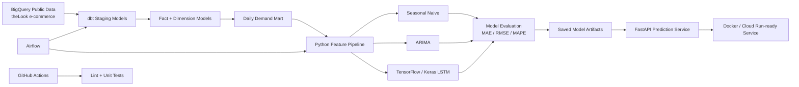

# Retail Demand Forecasting & Data Platform

An end-to-end portfolio project that combines **data engineering, analytics engineering, machine learning, model serving, testing, CI, and orchestration** around a realistic retail demand-forecasting use case.

The project uses Google's public **theLook e-commerce** dataset in BigQuery and is designed to mirror the kinds of patterns used in modern data/ML teams: raw source data → tested transformations → analytical marts → forecasting models → API serving → automated quality checks.

> **Why I built this:** to demonstrate how I would move from raw cloud data to reliable, reusable datasets and then into an ML product that can be consumed by another software system.

## Tech Stack

- **Cloud warehouse:** Google BigQuery / GCP
- **Transformation:** dbt + SQL
- **Programming:** Python, Pandas, NumPy
- **Forecasting:** Seasonal naive, ARIMA, TensorFlow/Keras LSTM
- **Model serving:** FastAPI
- **Containerisation:** Docker
- **Orchestration:** Apache Airflow DAG
- **Testing:** pytest + dbt tests
- **CI:** GitHub Actions
- **Version control:** Git/GitHub

## Architecture



## Data Model

The dbt project follows a layered pattern:

```text
bigquery-public-data.thelook_ecommerce
              |
              v
          staging/
  stg_orders
  stg_order_items
  stg_products
              |
              v
            marts/
  dim_products
  fct_order_items
  mart_daily_category_demand
              |
              v
      forecasting pipeline
```

The demand mart is at **date × product category** grain and contains:

- units sold
- number of orders
- gross revenue
- average selling price
- day-of-week / month features
- weekend indicator

## Data Quality

The dbt layer includes automated checks for:

- primary-key uniqueness
- required fields / nulls
- product referential integrity
- valid downstream relationships

The repository also includes an example operational monitoring query in `sql/data_quality_monitoring.sql`.

## Forecasting Approach

The project deliberately compares a complex model against simpler baselines.

### 1. Weekly seasonal naive
Uses the demand observed seven days earlier as the prediction. This is the minimum benchmark a more complex model should beat.

### 2. ARIMA
Provides a classical statistical forecasting baseline and allows comparison with a deep-learning approach.

### 3. TensorFlow/Keras LSTM
Uses the previous 28 days of demand to predict the next day. Forecasts can be generated recursively for a short horizon.

### Evaluation

The test set is held out **chronologically** rather than randomly to avoid time leakage.

Models are compared using:

- MAE
- RMSE
- MAPE

> The repository intentionally does **not** hard-code claimed performance numbers. Metrics are written to `artifacts/metrics.json` after the model is actually trained, so results remain reproducible and honest.

## Model Serving

The trained TensorFlow model is exposed through FastAPI.

### Health check

```bash
GET /health
```

### Forecast request

```bash
POST /predict
```

Example payload:

```json
{
  "recent_units_sold": [12, 11, 14, 13, 16, 15, 17, 12, 14, 18, 16, 15, 17, 19, 18, 20, 17, 16, 18, 21, 20, 19, 22, 21, 23, 20, 24, 22],
  "horizon": 7
}
```

## Repository Structure

```text
.
├── .github/workflows/ci.yml
├── airflow/dags/demand_pipeline.py
├── artifacts/
├── dbt/
│   ├── dbt_project.yml
│   ├── profiles.example.yml
│   └── models/
│       ├── staging/
│       └── marts/
├── docs/
│   ├── cv_bullets.md
│   └── interview_notes.md
├── sql/data_quality_monitoring.sql
├── src/
│   ├── api/main.py
│   ├── baselines.py
│   ├── config.py
│   ├── extract.py
│   ├── features.py
│   ├── metrics.py
│   ├── model.py
│   ├── predict.py
│   └── train.py
├── tests/
├── Dockerfile
├── Makefile
└── requirements.txt
```

## Getting Started

### 1. Create a GCP project

Enable BigQuery and authenticate locally with the Google Cloud SDK.

```bash
gcloud auth application-default login
```

BigQuery public datasets are queryable directly; you pay only for your own query processing subject to Google's current pricing/free-tier terms.

### 2. Create a virtual environment

```bash
python -m venv .venv
source .venv/bin/activate       # macOS/Linux
# .venv\Scripts\activate        # Windows
pip install -r requirements-dev.txt
```

### 3. Configure environment variables

```bash
cp .env.example .env
```

Set:

```text
GCP_PROJECT_ID=<your-project-id>
BQ_DATASET=retail_demand
BQ_LOCATION=US
FORECAST_CATEGORY=<category-to-model>
```

### 4. Configure dbt

```bash
cp dbt/profiles.example.yml dbt/profiles.yml
cd dbt
```

Check the connection:

```bash
dbt debug --profiles-dir .
```

Build and test the warehouse models:

```bash
dbt build --profiles-dir .
```

### 5. Train and evaluate the forecast models

From the repository root:

```bash
python -m src.train
```

Outputs are written to `artifacts/`:

```text
demand_lstm.keras
scaler.pkl
metrics.json
metadata.json
forecast_evaluation.png
```

### 6. Run the API

```bash
uvicorn src.api.main:app --reload --port 8080
```

Interactive API documentation:

```text
http://localhost:8080/docs
```

### 7. Run automated tests

```bash
pytest -q
ruff check src tests
```

## Docker

Build:

```bash
docker build -t retail-demand-api .
```

Run:

```bash
docker run --rm -p 8080:8080 retail-demand-api
```

The Docker configuration deliberately uses a standard Python image rather than the old deprecated FastAPI base image.

## CI

`.github/workflows/ci.yml` runs on pushes to `main` and pull requests. It performs:

1. Python setup
2. dependency installation
3. Ruff linting
4. pytest unit tests

A production extension would also authenticate to GCP and run `dbt build` against an isolated CI dataset.

## Airflow

`airflow/dags/demand_pipeline.py` shows how the workflow can be orchestrated:

```text
dbt build → model training → unit tests
```

For a production system I would separate training/deployment schedules, add retries/SLA alerting, use secrets management, version model artifacts, and gate deployment on evaluation thresholds.

## Production Improvements

If this were taken beyond a portfolio implementation, my next steps would be:

- multi-category/global forecasting instead of one category at a time
- richer inventory, promotions, calendar and fulfilment features
- probabilistic prediction intervals
- transformer-based time-series architectures
- BigQuery partitioning/clustering strategy for larger marts
- incremental dbt models
- model registry and experiment tracking
- prediction/data-drift monitoring
- scheduled retraining based on performance thresholds
- Cloud Run deployment with authenticated endpoints
- infrastructure-as-code using Terraform
- Grafana/Cloud Monitoring dashboards and alerts

## What This Project Demonstrates

### Data Engineering
- SQL transformations
- ELT architecture
- dbt modelling and tests
- fact/dimension modelling
- BigQuery/GCP
- data quality and validation
- Airflow orchestration
- Git/GitHub + CI

### Data Science / ML Engineering
- forecasting and time-series validation
- baseline comparison
- ARIMA
- TensorFlow/Keras deep learning
- model evaluation
- reproducible training code
- model serving with FastAPI
- Docker/containerisation
- production-monitoring thinking

## Limitations

- theLook is a **synthetic** e-commerce dataset, so this project demonstrates technical methodology rather than claiming real commercial impact
- the LSTM is intentionally compact and explainable; it is not presented as state-of-the-art forecasting
- the Airflow DAG demonstrates orchestration design but needs environment-specific deployment configuration
- production observability and infrastructure-as-code are documented as extensions rather than falsely presented as completed enterprise infrastructure

## Author

**Mamoon Zafar**  
MSc Data Science | Python | SQL | Machine Learning | Data Engineering

GitHub: [Mamoon28](https://github.com/Mamoon28)
